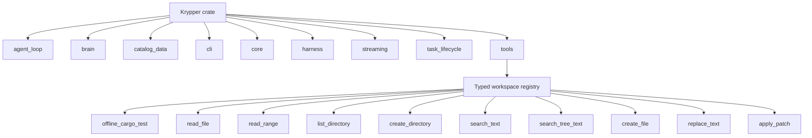

# Krypper

A local-first Rust CLI and in-process agent task runtime. Work with files in a bounded workspace, run task turns, and optionally connect to supported AI model providers.

## Install

**Build from source** (requires Rust and Cargo):

```sh
git clone https://github.com/KrypperX/krypper.git
cd krypper
cargo build --release
```

The executable is `target/release/krypper`. Run it from the directory you want to use as your workspace.

## Commands at a glance

| Command | Purpose |
| --- | --- |
| `krypper list [path]` | List entries in a workspace directory |
| `krypper show <path>` | Display a UTF-8 file |
| `krypper write <path> <text>` | Create a new file |
| `krypper task --goal <goal> --max-actions <n>` | Run a bounded task |
| `krypper models` | Browse the offline model catalog |

## Quick start

```sh
# List files in the current workspace
./target/release/krypper list

# Read a file
./target/release/krypper show README.md

# Start a bounded, caller-directed task
./target/release/krypper task --goal "Summarize the brief" --max-actions 3
```

Task actions can also be selected by an explicitly configured model. See the [CLI and runtime reference](docs/CLI_REFERENCE.md) for provider setup, task controls, and safety limits.

## Architecture

<!-- architecture:generated:start -->

<!-- architecture:generated:end -->
Generated from declared crate modules and the typed workspace operation registry. This inventory does not represent runtime call edges. Update with `cargo run --example generate_architecture`. See [Development guide](DEVELOPMENT.md) for the detailed implementation and proposed changes.

## Documentation

- [CLI and runtime reference](docs/CLI_REFERENCE.md) — commands, model providers, checkpoints, streaming, and safety constraints
- [Development guide](DEVELOPMENT.md) — code layout, architectural boundaries, and migration notes
- [Documentation directory](docs/) — focused technical guides

## Contributing

See the repository's existing development guidance and pull requests before proposing changes. Run `cargo test` locally when changing Rust code.
