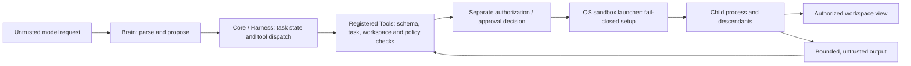
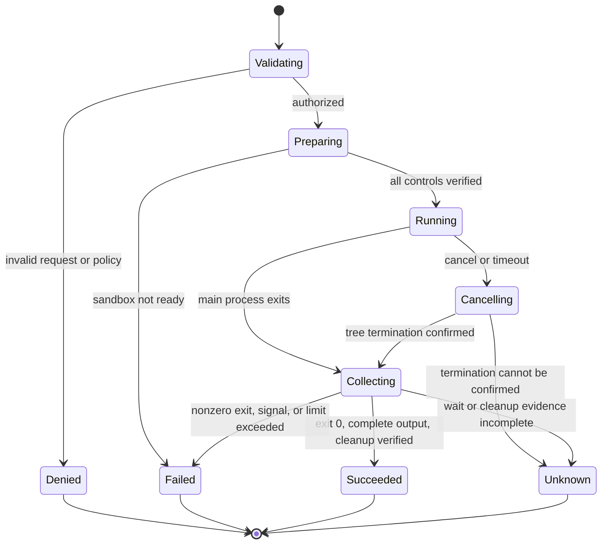

# Proposed Process-Execution Safety Boundary

> **Historical design proposal (#176).** The observations below describe the inspected base revision, not current capabilities. Issues #178 and #78 implement the [fixed offline Cargo profile and bounded direct-argv profile](offline-cargo-profile.md); that document describes their actual authorization, host requirements, confinement, limits and verification. The broader contracts here remain a requirements reference, not a claim that every proposed feature is implemented.
>
> See [the historical Cargo implementation snapshot](#current-state-at-dcd22b53b176668ae4b5f134d98b21b84ce55f40), the [C3 direct-argv update](#c3-direct-argv-update), and the [Linux Full Access host-process update](#linux-full-access-host-process-update) for implemented behavior. The remaining sections are retained as the original requirements and threat model.

## Current state at dcd22b53b176668ae4b5f134d98b21b84ce55f40

This section describes the process path in the current `main` revision. It separates runtime authority from descriptive metadata and does not claim host-level confinement from ordinary CI alone.

### Implemented authority path

```text
Brain / caller: OfflineCargoTest action with an optional literal test filter
  Harness: existing action budget, typed process observation and failure correction
    TaskSession: owning task + running turn + explicit per-task host grant
      Tools: registered process operation -> fixed Cargo policy -> supervisor
        host lease + systemd transient unit + cgroup readbacks + Bubblewrap probe
          fixed Cargo argv inside the verified sandbox
```

The authoritative runtime checks are:

- `TaskSession::run_offline_cargo_tests` in `src/core/lifecycle/session.rs` checks task ownership, running-turn state, grant presence and workspace binding.
- `workspace_operations` and `OperationDefinition` in `src/tools/registry.rs` define the registered `offline_cargo_test` operation, its closed request schema and descriptive effect.
- `execute_action` in `src/harness/execution/action.rs` dispatches the action and records its typed process observation.
- `validate_test_filter` and `cargo_command_args` in `src/tools/process/policy.rs` validate the optional filter and construct the fixed argument list.
- `src/tools/process/supervisor.rs` adapts the Tools-owned policy and captured workspace handles to the private sandbox crate, then maps its typed result back to the existing Product outcome.
- `run_with_containment` and `settle_before_launch` in `crates/krypper-sandbox/src/linux.rs` implement fail-closed readiness, cleanup, cancellation, leases and resource-readback gates. `crates/krypper-sandbox/src/sandbox.rs` constructs the fixed Bubblewrap command, mounts, namespaces, payload environment and descriptor hygiene.

Registry effect descriptions, tool metadata and model output are descriptive inputs only; they do not authorize a process. The versioned descriptor in `src/tools/process_profile.rs` is also descriptive: its own module contract says it registers no tool, grants no authority, selects no sandbox and launches no process. The fixed policy validates the `offline_cargo_test` descriptor and uses its executable, argument prefix and limits; cwd, environment values, sandbox flags and enforcement remain owned by the policy and supervisor.

The sandbox crate is a private Cargo workspace member. It accepts only captured directory handles, the optional validated test filter, fixed bounded limits and cancellation state; it has no API for choosing a command, environment, mounts or authorization grant. The extraction preserves the existing Bubblewrap and cgroup behavior and does not claim lower runtime overhead or additional platform support.

### Implemented boundaries

- **Dispatch:** the validated fixed profile is held by a host-built policy, granted to one task by `TaskSession`, and reached only through the registered `offline_cargo_test` Harness action. A task without that grant, or a run without containment, denies before any workspace code is launched.
- **Request:** only an optional literal `test_filter` is accepted. Empty, control-character, option-like and over-limit values are rejected before setup. Requests cannot choose an executable, other argv, cwd, environment, sandbox flags or higher limits.
- **Environment:** host helper commands receive a minimal service environment; the payload starts with `--clearenv` and receives only twelve fixed non-secret variables. Cargo dev/test debug symbols and incremental compilation are disabled to keep build artifacts within the per-file limit. No parent credentials, proxy variables, control sockets or arbitrary `PATH` are forwarded. Absence of secrets is asserted by an ignored host fixture, not by ordinary CI.
- **Filesystem and network:** the workspace and selected trusted runtime directories are mounted read-only; private `/tmp` provides bounded scratch space, while `/cargo/registry` is read-only. Bubblewrap unshares the network namespace. There is no direct-spawn fallback.
- **Syscalls:** the fixed Linux offline Cargo profile passes the same immutable seccomp program to its trusted readiness probe and Cargo process tree. It returns `EPERM` for ptrace and cross-process memory inspection, keyring requests, io_uring entry points, and vsock socket creation; Unix-domain sockets remain allowed. A wrong syscall architecture is killed, and unsupported Linux targets fail before Cargo starts. This is defense in depth alongside the namespace, mount and cgroup controls; it is not a filesystem or general-purpose sandbox.
- **Readiness:** a non-root Linux gate, exclusive host lease, transient cgroup with finite control readbacks and a `/usr/bin/true` probe through the exact Bubblewrap command precede workspace code. Missing primitives deny the run.
- **Limits and output:** fixed public limits are 180 wall seconds, 120 aggregate CPU seconds, 3 GiB memory, 128 processes, 256 descriptors, 64 MiB per file, 256 KiB combined raw stdout/stderr and a transient-unit bound 15 seconds above the wall limit. Output retains stream identity, is lossily decoded and is marked truncated when the cap is reached. CPU accounting is poll-based and can overshoot slightly.
- **Outcomes and cleanup:** typed results distinguish denial, sandbox/setup failure, spawn failure, signals, timeouts, cancellation, resource/output limits, zero matches and unknown outcomes. Results also carry bounded audit metadata (elapsed milliseconds, retained raw pipe bytes and enforced output byte count, ordered kernel limit events and a recovery-hold flag) in the existing process observation. Outcome selection is deterministic: unconfirmed cleanup outranks kernel limit events, which outrank the observed stop condition. Cleanup uses whole-cgroup termination plus direct-child reaping; uncertain cleanup latches further runs, marks results with the recovery hold and preserves the lease. The versioned approval digest is an internal consistency binding, not an authenticated token. The C3 direct-argv profile below adds the request and workspace-revision binding for its exact one-shot grant.

### Evidence classes

- **Ordinary CI verifies** request-schema and filter denial, missing-grant denial, approved-profile dispatch through TaskSession and Harness, deterministic missing-containment denial, lifecycle/ownership gates, required cgroup readback with fake files, grant loss on checkpoint restore, fixed argv placement, per-test execution evidence and zero-match retyping, synthetic correction flow, and observation/CLI rendering. It does not exercise real namespaces.
- **Ignored host fixtures** exercise the actual sandbox, supervisor, canaries, absent secrets and sockets, loopback denial, escape denial, the syscall filter in Cargo and a descendant, nonzero exit, timeout, output/resource ceilings, cancellation and cleanup. They require a preprovisioned toolchain/registry, delegated cgroup v2 and a user systemd manager, so their results are local host evidence, not required CI. The syscall fixture first checks that the host itself does not already return `EPERM` for its denied-call probes.
- **Source review only:** Bubblewrap flag semantics, namespace isolation from inside the payload, `pre_exec` cgroup attachment, `close_range` descriptor hygiene, delegated-subtree checks, crash-time lease recovery and cross-process cleanup holds are read from code but not proven by ordinary tests on a generic runner.

### Relation to the versioned profile descriptor

`src/tools/process_profile.rs` preserves the v1 descriptor constructor as metadata-only. The fixed `offline_cargo_test` profile is version 2 and stores a `ValidatedExecutionRequirements` value with private fields: fixed Cargo executable and argv prefix, workspace-relative cwd, logical read-only `Workspace`, `Toolchain`, and `CargoRegistry` roles, reviewed environment names, profile ceilings, deny-all network, the fixed `OfflineCargoTestV1` syscall profile, and an ephemeral process tree. Environment values remain fixed in the sandbox; the request carries names only. Logical roles map to the corresponding captured directory descriptors rather than caller-supplied paths.

The Tools adapter carries that profile-owned contract into `SandboxRunRequest` alongside the host-captured handles, separate effective run limits, optional validated literal test filter, and cancellation state. The common runner boundary rejects a non-exact contract or resource mapping before platform dispatch, and rejects invalid, overflowing, out-of-runner, or over-ceiling effective limits before any probe or payload. Profile ceilings use seconds for wall time and milliseconds for CPU; checked conversion yields per-run milliseconds and microseconds. Lower effective values are permitted for private fixtures.

Requested requirements are distinct from `SandboxIsolationEvidence`, which remains the result's separate bounded record of requested/applied/unavailable/unknown setup controls. Neither the contract nor an `applied` setup record alone establishes behavioral confinement. Host enforcement claims require relevant behavioral fixture evidence. Version 1 metadata does not provide execution requirements or launch authority, and the v2 contract does not replace TaskSession and registered Tools authorization.

### Current unknowns

Supported OS set remains Linux-only in code; Bubblewrap feature/version detection, in-payload namespace assertions, PID-reuse protection, stream sequence identifiers, an authenticated approval token and cross-process recovery after a supervisor crash are not established by ordinary CI. macOS and Windows behavior is unknown. A broader profile or dispatch path requires separate design, tests and review.

## C3 direct-argv update

This addendum records the implemented bounded `offline_read_only_exec` operation.
It is a separate profile from the fixed `offline_cargo_test` operation and does
not change that operation's request, argv, limits, or authorization wording.

The model may select only the registered `cargo` or `rustc` executable identity,
1 to 32 direct argv entries (at most 1,024 bytes each and 4,096 bytes total),
and a normalized workspace-relative working directory. Parsing rejects unknown
fields. There is no shell-text, executable-path, environment, sandbox-setting,
network, or limit input. The host resolves the executable from its pinned
toolchain; argv entries are forwarded literally and are never shell-parsed.

The host process profile supplies the fixed environment, 90-second wall limit,
60 CPU-second limit, 1.5 GiB memory limit, 128 KiB combined output cap, 64
process ceiling, deny-all network policy, ephemeral process tree, pinned
read-only workspace/toolchain/registry mounts, and private temporary filesystems.
It also requires Landlock write confinement in addition to the common Linux
sandbox controls. A cwd other than `.` is opened beneath the captured workspace
without following symlinks and pinned for the sandbox mount. Missing required
controls fail closed before payload launch.

In Ask and Risk-based modes, the Harness asks the trusted host to approve each
exact direct-argv action. After a positive answer, TaskSession derives a
one-shot `ExactIntent` grant from the task's current active, unexpired,
unconsumed host-installed process policy. The grant binds the exact request and
workspace revision, expires after 60 seconds, and is consumed at the guarded
spawn. Missing or stale policy, a denied or unavailable prompt, or a changed
request fails closed. The model cannot authorize the action. After a one-shot is
consumed, the host must provision a fresh active policy grant before a later
direct-argv request can run. The current CLI does not provision this policy or
interactive prompt; embeddings must provide them through the existing host
authorization path.

The original sections below remain a historical threat model and proposal. If
their open questions conflict with this addendum or
[`offline-cargo-profile.md`](offline-cargo-profile.md), use the implemented
behavior documented here; all other proposed capabilities remain unimplemented
unless documented separately.

## Request, evidence, and acceptance

This note responds to Issue [#176](https://github.com/KrypperX/krypper/issues/176), “Define process-execution safety boundary before implementation.” Its structured request is:

- **Objective:** define safe boundaries for a possible future process-execution capability before implementing an executor.
- **Scope:** inspect product code and tests at the task base revision; separate observed behavior, proposals, and unresolved assumptions; define boundaries and contracts for command input and authorization, workspace and cwd, environment and secrets, sandbox readiness, approval, resources and output, identity and lifecycle, streaming, cancellation, signals and exit status, and errors/unknown outcomes; analyze path, symlink, injection, hostile-output and interruption risks; give concrete allowed/denied cases and focused tests; compare approaches, dependencies, platform assumptions, open questions, and a revisit trigger.
- **Boundaries:** documentation only. Do not add an executor or Tool, run commands through the product, or change runtime behavior, permissions, dependencies, host infrastructure, CI governance, network policy, or user-visible CLI behavior. No hosted provider or external service is required.
- **Acceptance criteria:** make proposal status explicit; identify trust boundaries, threat assumptions, assets, and non-goals; require fail-closed sandbox readiness and preserve registered Tools authorization; cover all listed contracts and label platform facts that remain unknown; include positive and denial/failure tests for sandbox absence, escape, denied command, timeout/cancellation, and limits; remain documentation-only and pass current-head Verify and independent Review before guarded merge.

The inspected base was `f1986975a2d0993a13166420172ce3c9848db44b` (the `main` head at inspection). The task asks for a design, not an implementation or a claim that sandboxing already exists.

## What exists at the inspected revision

These are observations from the repository at the base SHA, not guarantees about a future executor:

- [`DEVELOPMENT.md`](../DEVELOPMENT.md) describes Core task/session lifecycle, Brain’s model-backed decision source, and the registered Tools boundary. It says registry metadata describes requests and does not itself grant authorization.
- [`src/tools/registry.rs`](../src/tools/registry.rs) registers eight workspace operations: file and range reads, directory listing/creation, text and tree search, file creation, and text replacement. The request schemas reject undeclared properties.
- [`src/brain/tests.rs`](../src/brain/tests.rs) checks that a model request named `run_shell` is rejected and does not write to the workspace. This is evidence about the current model-call path only.
- [`src/tools/workspace_safety.rs`](../src/tools/workspace_safety.rs) and the lifecycle/CLI tests cover current workspace-file path, symlink, and resource-safety behavior. Those checks do not sandbox a child process.
- Brain proposes tool calls; Core/`TaskSession` owns task lifecycle and validation; registered Tools perform the current bounded workspace operations. There is no production child-process launch path in `src/` at this revision. Process launches used by tests are test infrastructure, not a product executor.
- [`README.md`](../README.md) says model output cannot request shell/process execution and notes that provider credentials may be present in the parent environment. A future child must not inherit that environment by default.
- Rust’s [`std::process::Command`](https://doc.rust-lang.org/std/process/struct.Command.html) takes arguments directly rather than parsing a shell command string, but inherits the parent environment and current directory unless configured otherwise. Avoiding a shell removes one parser boundary; it does not make an arbitrary executable or its arguments safe.

No sandbox, child-process policy, command approval flow, cross-platform process-tree containment, or resource budget is established by this evidence. The existing file-Tool protections must not be described as process confinement.

## Threat model and boundaries

### Assets and assumptions

Protect the authorized workspace and its integrity, provider and host credentials, files outside the workspace, sibling tasks and processes, host availability, and the integrity of tool results and user-visible output. Treat model proposals, task/Issue text, repository files and scripts, dependency/build hooks, command output, and child exit metadata as untrusted. A child may be buggy or intentionally hostile, fork descendants, exploit path races, emit terminal control sequences, consume resources, or ignore graceful cancellation.

The proposal trusts the host policy source, the verified executor/sandbox setup, and the OS kernel/hypervisor boundary selected for a platform. It does not claim to contain a kernel or sandbox-runtime escape. Concurrent changes to the workspace by other tools are possible; approval and launch must bind to a well-defined request and the workspace root identity. The design does not make repository code trustworthy merely because an Owner approved running a named test profile.

### Request and authority flow



| Boundary | Proposed responsibility | Must not imply |
| --- | --- | --- |
| Model → Brain | Parse a structured request; reject malformed/unknown fields. | Model text is an executable command or authorization. |
| Brain → Core/Harness | A proposal enters the normal task lifecycle and dispatch path. | A model-selected tool name bypasses Core task ownership or state checks. |
| Core/Harness → registered Tools | Validate active task, workspace binding, lifecycle, and the registered Tool contract. | Registry metadata alone grants access, or a generic process Tool supersedes existing Tools policy. |
| Tools → authorization | Check fixed command profile, caller/task policy, exact approval where required, and limits. | Approval for one command authorizes changed args, cwd, workspace, environment, profile, or executable. |
| Authorization → OS | Pass only a fully validated immutable launch specification to the sandbox launcher. | A command string, environment patch, or caller-provided sandbox flags are trusted. |
| OS → child/workspace | Constrain mounts, identity, network, resources, and process tree before exec. | A cwd check alone confines filesystem access. |
| Child → output consumer | Stream bounded bytes tagged to one run; preserve provenance and report truncation/failure. | Child output is trusted instructions, safe terminal text, or evidence of successful completion. |

## Proposed request and authorization contract

The profile constraints in this section apply to sandboxed process profiles. The
explicit Linux Full Access exception is documented later: it permits a
user-confirmed direct-argv host process without Krypper sandboxing.

Do not add an unrestricted `shell(command: string)` interface. A future registered Tool should accept a closed, versioned schema with a policy-owned **profile ID**, a bounded list of validated argument values, and a workspace-relative cwd. For example, a profile may define a fixed executable and permitted argument grammar while the request supplies only a test selection. Unknown fields, arbitrary executable paths, shell fragments, environment edits, sandbox flags, resource-limit increases, host paths, and user-selected output destinations are rejected.

The launcher passes an argv vector directly; it never constructs a shell string. Profiles reject shell/interpreter entry points and options that change the executable, load plugins/configuration from outside the workspace, launch a daemon, or weaken profile limits. Because an executable can itself interpret arguments, profile validation is command-specific; “no shell parsing” alone is not authorization. A profile must document whether it intentionally runs project-controlled build scripts or tests and constrain them with the same sandbox.

The process Tool remains subject to the existing registered Tools policy, task ownership, workspace binding, and lifecycle checks. It is a new capability that must be explicitly registered and authorized; Brain/Harness cannot invoke a hidden launch path, and no argv option, nested script, alternate CLI route, or executable callback can grant capabilities denied to the task or existing Tools policy. Authorization is the intersection of task policy, profile policy, and sandbox capabilities. A denial is final for that attempt and produces no child process.

An approval, when policy requires one, is separate from model output and bound to a canonical digest of the profile/version, executable identity, argv, cwd, workspace identity/revision, allowed environment, resource limits, and sandbox policy. Any changed field requires fresh approval. Unattended execution without a valid preauthorization is denied; the model cannot approve itself. Whether the product has an interactive approver and how a policy owner grants reusable profile authorization are **unknown** and must be decided before implementation. Do not change current CLI interaction to fill that gap in this documentation task.

## Workspace, cwd, and filesystem contract

- Resolve the authorized workspace root once and bind launch to its identity, not merely its string path. Accept cwd only as a normalized relative path under that root; reject absolute paths, NULs, empty/ambiguous components, and `..` traversal.
- Resolve cwd relative to a held root directory handle using race-resistant, beneath-root resolution. On Linux, `openat2` with appropriate `RESOLVE_BENEATH` and `RESOLVE_NO_MAGICLINKS`-style constraints is one candidate; required flags and kernel availability need verification. A prior `canonicalize` check followed by path-based launch is insufficient against replacement races.
- The child sees a sandbox filesystem assembled from the workspace plus explicitly selected, read-only runtime/toolchain files and a private bounded temporary area. Host home directories, credential stores, agent sockets, control sockets, unrelated workspaces, and arbitrary host paths are absent. Workspace symlinks must not expose host paths; they resolve only within the sandbox view or fail. A minimal runtime view is not permission to read arbitrary host files.
- Workspace writes are limited to the authorized workspace and private temporary storage. Whether generated outputs may be copied back from a temporary area must be specified by a profile. The executor reports paths as workspace-relative and does not follow child-provided paths outside the view.

Mount namespaces, a dedicated root, descriptor-based resolution, and filesystem access controls are complementary. A namespace alone does not select safe mounts; a cwd prefix check alone does not stop later symlink traversal.

## Environment, secrets, and network

Start from an empty environment. Add only policy-defined non-secret variables needed by the profile (for example locale or a known toolchain location); do not inherit provider credentials, GitHub/App tokens, cloud credentials, proxy credentials, SSH agents, shell startup variables, or arbitrary parent `PATH`. Resolve the executable through trusted profile configuration, not a child-controlled search path. Close stdin by default, provide no TTY, and close all unrelated inherited file descriptors. Temporary paths are private to the run and cleaned after confirmed termination.

The proposed default sandbox has no network access. A future profile requiring network would need a separately reviewed, explicit policy and constrained egress contract; this note does not authorize it or change current network behavior. No secret injection mechanism is specified. If a future use case needs credentials, it requires a separate design for least privilege, non-exportability, lifetime, and exfiltration controls rather than adding secrets to the child environment.

## Sandbox readiness and fail-closed behavior

Before starting any child, the host must establish all required isolation and resource controls for the selected platform: private filesystem view, workspace-only write access, non-privileged identity, process-tree containment, network policy, and hard resource ceilings. Verify setup results, not just the presence/version of a sandbox executable. If a required namespace, mount, policy, limit, or containment primitive is unavailable or cannot be verified, return `sandbox_unavailable`/`sandbox_setup_failed` and start no child. Never fall back to direct `Command::spawn`, a shell, a weaker profile, or “best effort” confinement.

For the fixed Linux offline Cargo profile, the implementation uses user/mount/PID/network namespaces, a minimal filesystem view, seccomp, cgroup v2 controls, and optional Landlock filesystem-write restrictions. Seccomp filters syscalls rather than filesystem paths; Landlock ABI support varies, so unsupported kernels report the control as unavailable and continue only if every existing required control succeeds. A post-detection Landlock setup failure starts no payload. These mechanisms solve different parts of the boundary and still require provisioned-host behavioral evidence. General process execution and macOS/Windows sandbox equivalents remain unspecified; Linux architectures outside the fixed profile fail closed.

## Bounds, output, lifecycle, and outcomes

Every profile must set finite limits for wall time, CPU, memory, process count, writable storage, open descriptors, argv/environment size, concurrent runs, and combined stdout/stderr bytes. Numeric defaults and per-platform enforcement mechanisms remain **unknown**; they must be reviewed and fixed before any executor can run. Missing enforcement is a setup failure, never an unlimited value. Exceeding a hard bound terminates the entire run and returns a typed limit outcome. No command can raise its own limits.

Capture stdout and stderr separately and drain both concurrently to avoid pipe deadlock. Associate chunks with a unique run ID, stream sequence, and stream name. Apply a bounded buffer/backpressure policy; if the configured output cap is exceeded, terminate the process tree and report `output_limit_exceeded` with an explicit truncated flag and retained byte count. Never silently present a prefix as complete output. Treat bytes as untrusted: decode with an explicit replacement/encoding policy and escape terminal control sequences in rendered views. Output may contain prompt injection or secrets; it must not be reinterpreted as instructions, tool calls, or trusted diagnostics.

Each attempt gets a host-generated run ID and an OS process identity protected against PID reuse where the platform supports it. The supervisor owns the process handle and containment group for the full lifetime. A successful spawn is not success: wait for the main process and all descendants to exit, collect both streams, and confirm containment cleanup. On cancellation or timeout, stop accepting new work, send a graceful termination to the contained process tree, wait a fixed policy grace period, then force-kill the complete tree. Return only after termination is confirmed. If the supervisor loses identity or cannot prove descendants are gone, report `outcome_unknown`, retain no success claim, and block unsafe retry until the operator or host can establish cleanup.

Proposed lifecycle:



Return a typed outcome that distinguishes `denied`, `sandbox_unavailable`, `sandbox_setup_failed`, `spawn_failed`, `exited(code)`, `signaled(signal)`, `timed_out`, `cancelled`, `resource_limit_exceeded(kind)`, `output_limit_exceeded`, and `outcome_unknown`. Exit code zero is success only after stream completion and cleanup verification. Signals are not converted into success or an invented exit code. Preserve the signal/limit/cancel reason independently from any final kill signal. Do not automatically retry unknown or partially executed commands: they may have changed the workspace before interruption.

## Concrete cases and proposed focused tests

These tests are design acceptance cases for a future implementation; none claim current process sandbox tests exist.

| Case | Expected result |
| --- | --- |
| Authorized profile `cargo-test` with valid test selector, cwd `.`, valid approval, and all controls ready | Starts only the configured executable with validated argv; child sees workspace and read-only runtime view; exit 0 plus complete output/cleanup returns success. |
| Model asks for `run_shell`, unknown profile, undeclared field, arbitrary executable, `sh -c`, interpreter, or option that overrides the profile | Reject before spawn; no child, workspace mutation, or fallback route. |
| cwd is absolute, contains `..`, names a symlink to an outside host path, or is swapped after validation | Reject or contain it within the sandbox view; assert a canary outside the workspace is unchanged and unreadable. |
| Required namespace, mount, network isolation, process containment, or hard limit is unavailable | Return sandbox unavailable/setup failure; assert spawn count is zero and no direct-spawn fallback occurs. |
| Parent environment contains provider/GitHub/cloud credentials, hostile `PATH`, or shell startup variables | Child receives none unless an explicitly reviewed non-secret variable is allowlisted; inherited descriptors and stdin are closed. |
| Approval is absent, expired, or bound to a different argv/cwd/head/profile/limit | Deny before spawn; changing one bound field invalidates approval. |
| Child exceeds wall/CPU, memory, PID, storage, FD, argv/environment, concurrency, or output limit | Enforce the configured limit; terminate the full tree where applicable; return the matching typed result and preserve the exact cause. |
| Child hangs, cancellation races with natural exit, or spawns a descendant that ignores graceful termination | Escalate after grace; do not return until the tree is confirmed dead; if that cannot be confirmed, report unknown and block retry. |
| Child emits invalid UTF-8, ANSI/terminal controls, prompt-injection text, or output faster than the consumer | Keep stream identity, apply bounded backpressure/cap, escape display controls, mark truncation, and never interpret output as instructions. |
| Child exits 0, exits nonzero, is signaled, spawn fails, or supervisor loses wait/cleanup evidence | Distinguish success, exact nonzero code, signal, spawn failure, and unknown; only verified zero exit and cleanup is success. |

## Approaches, dependencies, and unresolved decisions

| Approach | Advantages | Costs and gaps |
| --- | --- | --- |
| Direct OS spawn with argv and hand-built restrictions | Simple, uses standard process APIs. | Does not provide filesystem, secret, network, process-tree, or resource confinement. Rejected as the executor boundary. |
| In-process Linux namespace/seccomp/Landlock/cgroup setup | Fine-grained control and no external service. | High security-critical implementation burden; kernel feature and delegation variability; mount and cleanup errors are easy to get wrong. |
| Dedicated unprivileged sandbox helper (for example Bubblewrap) | Reuses mature namespace/root-view setup and keeps policy at the caller. | Adds a trusted executable/version/configuration dependency; still needs verified resource, network, environment, and output policy. Availability/configuration is unknown. |
| systemd transient unit/scope | Can delegate lifecycle and resource controls to the system manager. | User-manager availability, delegation, and policy vary by host; may not provide a minimal filesystem view by itself. |
| OCI runtime | Clear image/rootfs and namespace model with established runtime specifications. | Larger runtime/rootfs operational footprint and configuration surface; availability and daemonless mode are unknown. |

Recommended design seam: a registered process Tool validates a versioned profile and produces an immutable launch specification; a separate sandbox launcher reports a verified readiness result and owns process-tree supervision; the Tool translates bounded byte streams and typed outcomes back into Core task state. Keep OS-specific launchers behind an interface, but do not claim cross-platform support until each backend passes the same confinement contract. Do not add any dependency until the platform and helper choice is approved and independently reviewed.

Open questions to resolve before implementation:

1. Which operating systems and minimum kernel/runtime versions are supported? Is an initial Linux-only capability acceptable?
2. Which sandbox backend and privilege/delegation model can the product reliably require on supported hosts?
3. What exact resource and output limits fit local development workloads, and how are they configured without user-controlled escalation?
4. Which fixed profiles are needed, which intentionally execute repository build scripts, and what approval mode governs each?
5. Is any network access required by a first profile? If yes, what separately governed egress policy applies?
6. What cancellation source and grace interval fit the current CLI/task lifecycle, and how should an unconfirmed orphan block subsequent runs?
7. Which minimal runtime/toolchain files are mounted read-only, and how are their identities pinned and updated?

Compatibility with other coding agents is a measurement question, not evidence of safety. If compatibility is requested, compare exact workflows, isolation, approval, and failure semantics against this contract in a future evaluation; do not copy another product’s defaults as proof.

Revisit this note before implementation if the supported OS set changes, a new command profile needs network or credentials, the sandbox backend cannot meet a contract, process output becomes a structured tool protocol, or observed development workloads require changing limits. Any contract relaxation requires a new threat review and explicit policy decision.

## Linux Full Access host-process update

The CLI supports a separate Linux-only `full_access_host_process` action when the
task has Full Access mode and the user confirms that mode through the controlling
terminal before provider startup. A saved preference or `--permission-mode`
selection does not authorize a task. Missing terminal access and declined
confirmation stop before the provider request.

The action accepts one executable, a bounded argv array, and a host working
directory. It does not parse shell text or accept model-selected environment,
sandbox, or resource settings. It executes with the current OS user's inherited
environment, filesystem, and network access. It has no Krypper process sandbox,
workspace fence, or egress restriction; outer OS/container policy still applies.
This mode does not grant root or authorize unknown actions, extension tools, the
fixed offline Cargo profile, or the bounded offline read-only profile.

The Linux runner uses a dedicated process group, a five-minute wall limit, a
one-MiB combined output cap, and bounded cleanup polling. Cancellation, timeout,
output overflow, or unconfirmed process-group/pipe cleanup cannot be reported as
successful. The cleanup flag covers only the launched process group and captured
pipe EOF; a child that calls `setsid` or otherwise escapes the group can survive
undetected, so the flag is not a tree-wide cleanup guarantee. Mode snapshots and
confirmation are task-local and absent after checkpoint restore.

## Primary platform references

These references describe candidate OS mechanisms, not product guarantees:

- Rust [`std::process::Command`](https://doc.rust-lang.org/std/process/struct.Command.html)
- Linux [`openat2(2)` path resolution](https://man7.org/linux/man-pages/man2/openat2.2.html), [user namespaces](https://man7.org/linux/man-pages/man7/user_namespaces.7.html), [mount namespaces](https://man7.org/linux/man-pages/man7/mount_namespaces.7.html), [seccomp filter](https://docs.kernel.org/userspace-api/seccomp_filter.html), and [Landlock](https://docs.kernel.org/userspace-api/landlock.html)
- Linux [cgroup v2](https://docs.kernel.org/admin-guide/cgroup-v2.html)
- [Bubblewrap](https://github.com/containers/bubblewrap), [systemd execution properties](https://www.freedesktop.org/software/systemd/man/latest/systemd.exec.html) and [resource control](https://www.freedesktop.org/software/systemd/man/latest/systemd.resource-control.html), and the [OCI Linux runtime configuration](https://github.com/opencontainers/runtime-spec/blob/main/config-linux.md)
