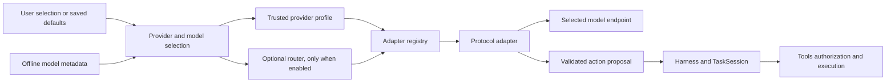

# Provider and model architecture contract

**Status:** current implementation and staged design contract. The code has an internal typed factory registry around the existing protocol adapters. Configurable provider profiles, automatic routing, and fallback are not implemented.

## Scope and baseline

This contract was checked against Product revision `8d22792928ac2d5878868ad93b4462873791a961` on 2026-11-24. It covers provider selection, adapter dispatch, model metadata, credentials, and safe migration. It does not change runtime behavior.

## Evidence and public API inventory

The public objective and staged requirements come from [issue #303](https://github.com/KrypperX/krypper/issues/303). The public repository sources reviewed for this baseline include `README.md`, `DEVELOPMENT.md`, the CLI reference, the offline catalog guide, [`docs/cloudflare-workers-ai-catalog-research.md`](cloudflare-workers-ai-catalog-research.md), and the provider-selection and adapter modules listed below. The research recommends keeping models.dev as the common offline catalog, using Cloudflare's feed only for supplemental Workers AI metadata, and treating catalog records as distinct from account inference access. No separate public product-goal document is present at this revision, so target claims are limited to issue #303 and observable product behavior.

As of 2026-11-24, the only open pull request was [#302](https://github.com/KrypperX/krypper/pull/302), for multi-file impact analysis; it does not overlap provider/model architecture. No open provider-architecture pull request was found at this baseline.

At the crate root, `src/lib.rs` re-exports `ModelProvider`, `OllamaDecisionSource`, and `ModelError`. Its public `extensions` module exports `ModelProvider`, `ModelError`, `AnthropicDecisionSource`, `GeminiDecisionSource`, `OpenAiCompatibleDecisionSource`, `OpenAiCompatibleProvider`, `ResponsesDecisionSource`, and `ResponsesProvider`. The provider-specific request builders are `build_anthropic_request_with_extensions`, `build_chat_request_with_extensions`, `build_compatible_chat_request_with_extensions`, `build_gemini_request_with_extensions`, and `build_responses_request_with_extensions`. `src/brain/mod.rs` re-exports those source and provider types from the private brain module so `src/lib.rs` can expose the host-facing API. `ModelDecisionSource`, `DecisionProtocol`, `ProviderCapabilities`, adapter IDs, and the source factory registry are crate-private implementation details, not public extension APIs.

The public catalog API is `krypper::catalog_data::{lookup, models, provider_matches, ModelSpec}`. It reads the bundled snapshot and exposes descriptive model metadata; it does not perform network access or select a provider.

Relevant tests cover several boundaries: `src/brain/providers/tests.rs` checks the capability and factory registries against all twelve selectors, duplicate/missing registration errors, and fake-adapter forwarding; `src/brain/tests/providers/` has protocol request, response, action, streaming, and extension-dispatch fixtures; and `src/brain/tests/endpoint.rs` checks endpoint rejection before request or credential use. `src/cli/model_tests.rs` and `src/cli/task_tests.rs` cover explicit provider selection, credentials, and preflight; `src/cli/setup.rs` has the setup-list test described below. Catalog behavior is covered in `src/catalog_data.rs` and generator validation in `examples/generate_model_catalog.rs`; provider event handling also has fixtures in `src/streaming/tests/provider.rs`.

## Current implementation

The CLI selects one model source. An explicit `--provider` selects a provider; saved model defaults can supply a provider and model; `--model` without a provider keeps the local Ollama default. Hosted selection is an explicit user setting and requires the corresponding credentials. The current CLI has twelve provider selectors across five protocol families:

| Protocol family | Selectors | Current behavior |
| --- | --- | --- |
| Ollama chat | `ollama` | Local endpoint. |
| Gemini GenerateContent | `gemini` | Native request and response mapping. |
| OpenAI Responses | `openai`, `xai` | Shared Responses adapter with provider-specific endpoints and credentials. |
| Anthropic Messages | `anthropic` | Native Messages adapter. |
| OpenAI-compatible chat completions | `cloudflare`, `cloudflare-ai-gateway`, `groq`, `openrouter`, `deepseek`, `zai`, `mistral` | Shared chat adapter with fixed provider endpoints. Cloudflare direct and Gateway use separate selectors; Gateway also accepts a gateway ID. |

The main code locations are:

- `src/brain/providers.rs` defines the public `ModelProvider` enum, maps providers to protocol-level capabilities and stable adapter IDs, registers factories for the five protocol families, and wraps each constructed source behind the internal `ModelDecisionSource` facade.
- `src/brain/providers/{anthropic,compatible,gemini,responses}.rs` implement the hosted protocol adapters; `OpenAiCompatibleProvider` is defined in `compatible.rs`. The local Ollama source remains in Brain's decision module.
- `src/cli/model_selection.rs` resolves provider defaults and credentials, validates model IDs, and builds the selected source through the typed registry. Provider-specific endpoints and credential requirements remain fixed in code.
- Provider selector names are repeated in `ModelProvider::parse`, the interactive choices in `src/cli/setup.rs`, the provider list in `src/cli/help.rs`, and the unsupported-provider error in `src/cli/task.rs`. The setup test checks that every setup entry parses and verifies both Cloudflare labels, but it does not prove setup includes every supported selector. `src/brain/providers/tests.rs` separately enumerates all twelve selectors for capability parity; CLI tests exercise explicit selection, help text, and unknown-provider rejection.
- `src/cli/settings.rs` stores model defaults and credentials in separate per-user files. Environment values override saved credential values. `KRYPPER_CONFIG` only selects model defaults; credential lookup stays in the per-user settings directory.
- `src/catalog_data.rs`, `snapshots/models-dev/`, and `docs/models-dev-catalog.md` provide the offline model metadata catalog. It is descriptive: it does not grant credentials, select a provider, or reject an unknown model ID. The catalog snapshot is not refreshed during normal execution.

`ModelSpec` currently holds provider and model IDs, display name, context/output limits, optional tool-calling and reasoning flags, status, and modalities. `ProviderCapabilities` is a separate internal type and currently describes protocol family and native SSE decision support. Neither type proves that a model is available to a particular account or works with a particular task.

Provider adapters return a proposed `WorkspaceAction`; they do not execute it. Harness owns the task loop, Core owns task/session lifecycle, and Tools remains the enforcement point for workspace effects. Provider output, catalog metadata, and routing decisions cannot grant permissions or expand the action budget.

## Dependency direction and target seams

The provider-selection interface should be reusable by current CLI commands and any future interface, while keeping provider-specific wire behavior inside adapters:

The target contract is:

1. A trusted provider profile describes a stable provider ID, aliases, protocol/adapter ID, fixed or validated endpoint policy, authentication scheme, credential references, declared features, discovery method, and profile provenance/version. It is executable configuration, so it is kept separate from upstream descriptive model metadata.
2. A typed registry resolves trusted adapter IDs to implementations. Duplicate or missing IDs fail deterministically. A task uses a stable selection snapshot; a configuration reload cannot silently switch its provider midway through an action.
3. Existing-protocol providers reuse the relevant protocol adapter. A genuinely new protocol adds a focused adapter that returns the existing validated decision contract; it does not add a second Harness loop or execution authority.
4. Model metadata remains optional and advisory. Unknown model IDs remain valid when the selected provider accepts them. Unknown capability or price data stays unknown; it is never interpreted as unsupported, available, or free.
5. Manual provider/model selection remains authoritative. Automatic routing is opt-in and returns an explainable selection or a specific no-candidate result. Catalog entries alone never enable a provider.
6. Fallback is opt-in, bounded, and limited to a safe task/turn boundary. A timeout or provider error after a tool effect may be ambiguous; the runtime must reconcile recorded state before retrying or switching providers.

## Trust and failure rules

- Provider choice, credential lookup, and endpoint validation happen before attaching credentials or sending task data. New profiles must bind credentials to validated trusted origins; reject any credential-bearing redirect that would forward authorization to another origin. Untrusted model/catalog/workspace content cannot supply an endpoint, credential destination, or permission.
- Hosted requests are a network and data-transfer choice. They send task context to the selected provider; the CLI must continue to make that choice visible and deliberate.
- Each adapter validates the response into the existing bounded action representation. Tool calls are proposals. Harness and Tools recheck action shape, workspace scope, budgets, and authorization before any effect.
- Preserve typed failures for authentication, rate limits, unavailable services, malformed responses, unsupported capabilities, cancellation, and unknown outcomes. Do not retry or switch providers after possible side effects without state reconciliation.
- Preserve explicit model overrides and environment-over-saved credential precedence. Never write secret values into the model catalog, provider metadata, task outcomes, or logs.
- Keep offline catalog use as the default metadata path. Refreshing catalog data remains an explicit developer action with version/hash/license checks and atomic replacement; normal task execution performs no implicit catalog fetch.

## Migration and rollback

The current public provider enums and constructors are compatibility surfaces. The internal adapter seam now wraps the existing source implementations and keeps their request/response behavior intact. Adding or changing a source must preserve the explicit-selection path and protocol fixtures. Provider descriptors can later drive setup/help enumeration from one source; only after that parity is established should user-defined trusted profiles or opt-in routing be added.

Configuration changes must be versioned and backward compatible. Use bounded parsing and atomic writes; keep credentials in the existing per-user credential store, referenced by name from profiles rather than copied into profile/catalog files. A rollback must allow the prior defaults and credential files to be read without a destructive reset. If a schema cannot be read or a profile fails validation, fail before any provider request and leave the previous valid configuration intact.

Each phase is a separate reviewable change. Reverting an adapter-registry phase must restore the existing enum dispatch without changing task lifecycle, CLI defaults, workspace permissions, or user credential data. Reverting a later profile or routing phase must leave manual provider selection and the offline catalog usable.

## Acceptance matrix for staged work

| Slice | Required observable checks before merge |
| --- | --- |
| Adapter interface and registry | Register a fake adapter; reject duplicate and missing IDs; run local fixtures for every migrated protocol; preserve one-action validation, streaming/non-streaming parity where supported, typed errors, cancellation propagation, optional usage propagation, and the existing action budget. Adding an adapter must not add a new Core dispatch path or execution loop. |
| Built-in provider profiles | Enumerate every existing selector and alias from one trusted description source; derive setup/help/catalog filtering and factory resolution from the shared metadata; prove parity, including distinct Cloudflare direct and Gateway selectors. Conflicts and unknown providers fail deterministically. |
| Per-user profile lifecycle | Add, disable, replace, and remove a mock OpenAI-compatible profile without source edits or a rebuild; preserve environment-over-saved precedence; reject malformed profiles, untrusted endpoints, workspace/model/catalog-controlled credential destinations, and credential-bearing cross-origin redirects before sending credentials; prove network use is explicit and task snapshots do not change during a running task. |
| Model catalog | Keep ordinary execution offline and refresh/import explicit, with bounded size and time. Verify generator/snapshot hashes, schema version, license notice, deterministic merge, last-known-good behavior, and Cloudflare ID mapping. With fixtures, reject stale, corrupt, duplicate, malformed, oversized, or slow imports; preserve unknown fields; handle an unavailable source; and exercise an alternate catalog source without rewriting adapters. Unknown model IDs stay selectable; unknown cost is not zero. |
| Capability evidence | Distinguish discoverable, executable, and configured providers; label declared, verified, and observed facts separately. Fixtures record bounded, redacted health, latency, rate-limit, and usage evidence per provider/model/configuration revision; prove prompts and secrets are not retained; and verify typed-error and token-usage propagation. Test missing credentials, unsupported protocol/features, stale evidence, account-specific availability, and unknown capability outcomes. Live probes require explicit opt-in. |
| Opt-in router | Manual selection and explicit model overrides always win. Rank fake candidates against task requirements, capability and health evidence, context limits, configured credentials, cost/latency/quality preferences, and budget; verify compatible and incompatible models, explicit precedence, deterministic tie-breaking, explainable reason codes, and a specific no-candidate result. Substitute a fixture alternate router without rewriting adapters. Unknown pricing and stale/unverified capability data cannot be treated as positive evidence. |
| Fallback and switching | Keep fallback disabled by default and switch only at a safe task/turn boundary. Bound retries, backoff, cancellation, and aggregate budgets; fixtures prove there is no silent provider switch, task-data transfer, or cost escalation. Inject 429/5xx, authentication, timeout, malformed response, partial tool-call/stream, cancellation, duplicate-action, exhausted-budget, and ambiguous-completion cases. No replay occurs after a possible tool side effect until state is reconciled. |
| CLI integration | Extend existing `models`, `setup`, and `status` interfaces; do not add parallel commands. Preserve existing flags, defaults, setup/reset behavior, noninteractive scripts, and machine-readable output. Share one API with the current CLI and any future TUI; do not put routing or credentials in the UI. Show readiness/provenance, selected route, and reason without exposing credentials. Expose explicit catalog refresh and manual/automatic configuration, and mark unsupported TUI behavior unavailable. Add snapshot and integration tests. |
| Evaluation | Reuse existing evaluation fixtures; compare manual and automatic selection on isolated representative coding, reasoning, and tool tasks with the same task/model/tool/permission and total budgets. Add offline deterministic tests and separately opt-in live tests. Report verified outcomes, actual versus estimated cost, latency, failures, safety regressions, limitations, and regression evidence; make no broad quality claim from one run. |

## Scope of this baseline document

This document records the current structure and staged testable contracts. The current implementation includes a crate-private typed factory registry around the five existing protocol families. It does not add provider profiles, automatic routing, fallback, dynamic code loading, or live provider probes. Those behaviors require the focused implementation and evidence described above.
