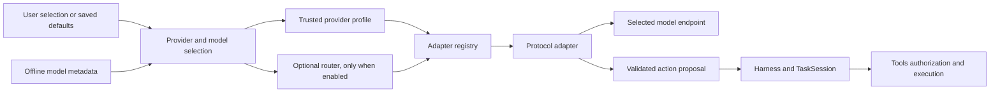

# Provider and model architecture contract

**Status:** current implementation and staged design contract. Built-in provider metadata is centralized in an internal typed catalog and resolves through the existing protocol adapter registry. The opt-in deterministic routing API, task-scoped bounded fallback decision source, and CLI routing integration are implemented. A terminal UI remains a separate integration; it must use the same routing contracts and leave provider configuration and credentials to the shared application layer.

## Scope and baseline

The implementation baseline for P3 is Product revision `e290e74e553f5b108b458009a1cf25a340cebeb3` on 2026-11-24. This contract covers provider selection, adapter dispatch, model metadata, credentials, and safe migration. P3 centralizes built-in provider metadata while preserving the existing selection and adapter behavior.

## Evidence and public API inventory

The public objective and staged requirements come from [issue #303](https://github.com/KrypperX/krypper/issues/303). The public repository sources reviewed for this baseline include `README.md`, `DEVELOPMENT.md`, the CLI reference, the offline catalog guide, [`docs/cloudflare-workers-ai-catalog-research.md`](cloudflare-workers-ai-catalog-research.md), and the provider-selection and adapter modules listed below. The research recommends keeping models.dev as the common offline catalog, using Cloudflare's feed only for supplemental Workers AI metadata, and treating catalog records as distinct from account inference access. No separate public product-goal document is present at this revision, so target claims are limited to issue #303 and observable product behavior.

As of 2026-11-24, the only open pull request was [#302](https://github.com/KrypperX/krypper/pull/302), for multi-file impact analysis; it does not overlap provider/model architecture. No open provider-architecture pull request was found at this baseline.

At the crate root, `src/lib.rs` re-exports `ModelProvider`, `OllamaDecisionSource`, and `ModelError`. Its public `extensions` module exports `ModelProvider`, `ModelError`, `AnthropicDecisionSource`, `GeminiDecisionSource`, `OpenAiCompatibleDecisionSource`, `OpenAiCompatibleProvider`, `ResponsesDecisionSource`, and `ResponsesProvider`. The provider-specific request builders are `build_anthropic_request_with_extensions`, `build_chat_request_with_extensions`, `build_compatible_chat_request_with_extensions`, `build_gemini_request_with_extensions`, and `build_responses_request_with_extensions`. `src/brain/mod.rs` re-exports those source and provider types from the private brain module so `src/lib.rs` can expose the host-facing API. `ModelDecisionSource`, `DecisionProtocol`, `ProviderCapabilities`, adapter IDs, and the source factory registry are crate-private implementation details, not public extension APIs.

The public catalog API is `krypper::catalog_data::{lookup, models, provider_matches, ModelSpec}`. It reads the bundled snapshot and exposes descriptive model metadata; it does not perform network access or select a provider.

Relevant tests cover several boundaries: `src/brain/providers/provider_catalog.rs` checks the exact selector order, alias conflicts, unknown providers, catalog mappings, auth fields, and adapter metadata; `src/brain/providers/tests.rs` checks descriptor/factory parity, duplicate/missing registration errors, and fake-adapter forwarding. `src/brain/tests/providers/` has protocol request, response, action, streaming, and extension-dispatch fixtures; `src/brain/tests/endpoint.rs` checks endpoint rejection before request or credential use. `src/cli/model_tests.rs` and `src/cli/task_tests.rs` cover explicit provider selection, help output, credentials, and preflight; `src/cli/setup.rs` checks that setup choices and labels come from the descriptor catalog. Catalog behavior is covered in `src/catalog_data.rs` and generator validation in `examples/generate_model_catalog.rs`; provider event handling also has fixtures in `src/streaming/tests/provider.rs`.

## Current implementation

The CLI selects one model source. An explicit `--provider` selects a provider; saved model defaults can supply a provider and model; `--model` without a provider keeps the local Ollama default. Hosted selection is an explicit user setting and requires the corresponding credentials. The current CLI has twelve provider selectors across five protocol families:

| Protocol family | Selectors | Current behavior |
| --- | --- | --- |
| Ollama chat | `ollama` | Local endpoint. |
| Gemini GenerateContent | `gemini` | Native request and response mapping. |
| OpenAI Responses | `openai`, `xai` | Shared Responses adapter with provider-specific endpoints and credentials. |
| Anthropic Messages | `anthropic` | Native Messages adapter. |
| OpenAI-compatible chat completions | `cloudflare`, `cloudflare-ai-gateway`, `groq`, `openrouter`, `deepseek`, `zai`, `mistral` | Shared chat adapter with fixed provider endpoints. Cloudflare direct and Gateway use separate selectors; Gateway also accepts a gateway ID. |

The trusted built-in metadata and main code locations are:

- `src/brain/providers/provider_catalog.rs` defines each built-in selector, aliases, display labels, protocol features, stable adapter ID, trusted endpoint metadata, auth fields, and descriptive catalog provider IDs. The trusted table is code-owned and remains separate from `models.dev` model records.
- `src/brain/providers.rs` defines the public `ModelProvider` enum, derives parsing and capabilities from descriptors, registers factories for the five protocol families, and wraps each constructed source behind the internal `ModelDecisionSource` facade.
- `src/brain/providers/{anthropic,compatible,gemini,responses}.rs` implement the hosted protocol adapters; `OpenAiCompatibleProvider` is defined in `compatible.rs`. The local Ollama source remains in Brain's decision module.
- `src/cli/model_selection.rs` resolves provider defaults and descriptor-declared credential fields, validates model IDs, and builds the selected source through the typed registry. Protocol-specific credential values remain typed before adapter construction.
- `src/cli/setup.rs`, `src/cli/help.rs`, and `src/cli/settings.rs` derive provider choices, labels, credential prompts/whitelisting, and provider endpoint/auth summaries from the same descriptors. `src/cli/model_tests.rs` checks the exact selector list and metadata-backed help output.
- `src/cli/settings.rs` stores model defaults and credentials in separate per-user files. Environment values override saved credential values. `KRYPPER_CONFIG` only selects model defaults; credential lookup stays in the per-user settings directory.
- `src/catalog_data.rs`, `snapshots/models-dev/`, and `docs/models-dev-catalog.md` provide the offline model metadata catalog. `provider_matches` uses trusted descriptor mappings, including Gemini's `google` catalog ID and the separate Cloudflare direct/Gateway mappings. The catalog is descriptive: it does not grant credentials or authorize endpoints, and unknown model IDs remain selectable. The snapshot is not refreshed during normal execution.

`ModelSpec` currently holds provider and model IDs, display name, context/output limits, optional tool-calling and reasoning flags, status, and modalities. `ProviderCapabilities` is a separate internal type and currently describes protocol family and native SSE decision support. Neither type proves that a model is available to a particular account or works with a particular task.

Provider adapters return a proposed `WorkspaceAction`; they do not execute it. Harness owns the task loop, Core owns task/session lifecycle, and Tools remains the enforcement point for workspace effects. Provider output, catalog metadata, and routing decisions cannot grant permissions or expand the action budget.

## Dependency direction and target seams

The provider-selection interface should be reusable by current CLI commands and any future interface, while keeping provider-specific wire behavior inside adapters:

The target contract for future configurable profiles and routing is:

1. Built-in provider descriptors are code-owned and trusted. Any future configurable provider profile must describe a stable provider ID, aliases, protocol/adapter ID, fixed or validated endpoint policy, authentication scheme, credential references, declared features, discovery method, and profile provenance/version. Executable configuration stays separate from upstream descriptive model metadata.
2. A typed registry resolves trusted adapter IDs to implementations. Duplicate or missing IDs fail deterministically. A task uses a stable selection snapshot; a configuration reload cannot silently switch its provider midway through an action.
3. Existing-protocol providers reuse the relevant protocol adapter. A genuinely new protocol adds a focused adapter that returns the existing validated decision contract; it does not add a second Harness loop or execution authority.
4. Model metadata remains optional and advisory. Unknown model IDs remain valid when the selected provider accepts them. Unknown capability or price data stays unknown; it is never interpreted as unsupported, available, or free.
5. Manual provider/model selection remains authoritative. Automatic routing is opt-in and returns an explainable selection or a specific no-candidate result. Catalog entries alone never enable a provider.
6. Fallback is opt-in, bounded, and limited to a safe task/turn boundary. A timeout or provider error after a tool effect may be ambiguous; the runtime must reconcile recorded state before retrying or switching providers.

## Trust and failure rules

- Provider choice, credential lookup, and endpoint validation happen before attaching credentials or sending task data. New profiles must bind credentials to validated trusted origins; reject any credential-bearing redirect that would forward authorization to another origin. Untrusted model/catalog/workspace content cannot supply an endpoint, credential destination, or permission.
- Hosted requests are a network and data-transfer choice. They send task context to the selected provider; the CLI must continue to make that choice visible and deliberate.
- Each adapter validates the response into the existing bounded action representation. Tool calls are proposals. Harness and Tools recheck action shape, workspace scope, budgets, and authorization before any effect.
- Preserve typed failures for authentication, rate limits, unavailable services, malformed responses, unsupported capabilities, cancellation, and unknown outcomes. Do not retry or switch providers after possible side effects without state reconciliation.
- Preserve explicit model overrides and environment-over-saved credential precedence. Never write secret values into the model catalog, provider metadata, task outcomes, or logs.
- Keep offline catalog use as the default metadata path. Refreshing catalog data remains an explicit developer action with version/hash/license checks and atomic replacement; normal task execution performs no implicit catalog fetch.

## Migration and rollback

The current public provider enums and constructors are compatibility surfaces. The internal adapter seam wraps the existing source implementations and keeps their request/response behavior intact. Adding or changing a source must preserve the explicit-selection path and protocol fixtures. The built-in descriptor catalog now drives provider parsing, setup/help enumeration, credential whitelisting, catalog mapping, and adapter selection. User-defined trusted profiles and opt-in routing remain later, separately reviewed work.

Configuration changes must be versioned and backward compatible. Use bounded parsing and atomic writes; keep credentials in the existing per-user credential store, referenced by name from profiles rather than copied into profile/catalog files. A rollback must allow the prior defaults and credential files to be read without a destructive reset. If a schema cannot be read or a profile fails validation, fail before any provider request and leave the previous valid configuration intact.

Each phase is a separate reviewable change. Reverting an adapter-registry phase must restore the existing enum dispatch without changing task lifecycle, CLI defaults, workspace permissions, or user credential data. Reverting a later profile or routing phase must leave manual provider selection and the offline catalog usable.

## Acceptance matrix for staged work

| Slice | Required observable checks before merge |
| --- | --- |
| Adapter interface and registry | Register a fake adapter; reject duplicate and missing IDs; run local fixtures for every migrated protocol; preserve one-action validation, streaming/non-streaming parity where supported, typed errors, cancellation propagation, optional usage propagation, and the existing action budget. Adding an adapter must not add a new Core dispatch path or execution loop. |
| Built-in provider descriptors | Enumerate every existing selector and alias from one trusted description source; derive parsing, setup/help/catalog filtering and factory resolution from the shared metadata; prove parity, including distinct Cloudflare direct and Gateway selectors and Gemini's Google catalog mapping. Conflicts and unknown providers fail deterministically. |
| Per-user profile lifecycle | Add, disable, replace, and remove a mock OpenAI-compatible profile without source edits or a rebuild; preserve environment-over-saved precedence; reject malformed profiles, untrusted endpoints, workspace/model/catalog-controlled credential destinations, and credential-bearing cross-origin redirects before sending credentials; prove network use is explicit and task snapshots do not change during a running task. |
| Model catalog | Keep ordinary execution offline and refresh/import explicit, with bounded size and time. Verify generator/snapshot hashes, schema version, license notice, deterministic merge, last-known-good behavior, and Cloudflare ID mapping. With fixtures, reject stale, corrupt, duplicate, malformed, oversized, or slow imports; preserve unknown fields; handle an unavailable source; and exercise an alternate catalog source without rewriting adapters. Unknown model IDs stay selectable; unknown cost is not zero. |
| Capability evidence | Distinguish discoverable, executable, and configured providers; label declared, verified, and observed facts separately. Fixtures record bounded, redacted health, latency, rate-limit, and usage evidence per provider/model/configuration revision; prove prompts and secrets are not retained; and verify typed-error and token-usage propagation. Test missing credentials, unsupported protocol/features, stale evidence, account-specific availability, and unknown capability outcomes. Live probes require explicit opt-in. |
| Opt-in router | Manual selection and explicit model overrides always win. Rank fake candidates against task requirements, capability and health evidence, context limits, configured credentials, cost/latency/quality preferences, and budget; verify compatible and incompatible models, explicit precedence, deterministic tie-breaking, explainable reason codes, and a specific no-candidate result. Substitute a fixture alternate router without rewriting adapters. Unknown pricing and stale/unverified capability data cannot be treated as positive evidence. |
| Fallback and switching | Keep fallback disabled by default and switch only at a safe task/turn boundary. Bound retries, backoff, cancellation, and aggregate budgets; fixtures prove there is no silent provider switch, task-data transfer, or cost escalation. Inject 429/5xx, authentication, timeout, malformed response, partial tool-call/stream, cancellation, duplicate-action, exhausted-budget, and ambiguous-completion cases. No replay occurs after a possible tool side effect until state is reconciled. |
| CLI integration | Extend existing `models`, `setup`, and `status` interfaces; do not add parallel commands. Preserve existing flags, defaults, setup/reset behavior, noninteractive scripts, and machine-readable output. Share one API with the current CLI and any future TUI; do not put routing or credentials in the UI. Show readiness/provenance, selected route, and reason without exposing credentials. Expose explicit catalog refresh and manual/automatic configuration, and mark unsupported TUI behavior unavailable. Add snapshot and integration tests. |
| Evaluation | Reuse existing evaluation fixtures; compare manual and automatic selection on isolated representative coding, reasoning, and tool tasks with the same task/model/tool/permission and total budgets. Add offline deterministic tests and separately opt-in live tests. Report verified outcomes, actual versus estimated cost, latency, failures, safety regressions, limitations, and regression evidence; make no broad quality claim from one run. |

## P6 implementation: capability resolution and runtime evidence

The terms used here are defined in the [project glossary](../GLOSSARY.md).

Provider descriptors and the offline model catalog supply declared facts. Missing catalog values stay unknown. An accepted `krypper setup` connection test is the explicit live probe; missing required credentials stop before the request. A successful probe verifies one decision request only for its selected provider, model, and account/configuration revision. It does not verify unrelated model features.

The capability evidence module keeps discoverable, executable, configured, and verified readiness as separate dimensions. It records declared model/provider facts, verified decision-request results, and observed health/latency/rate-limit/token-usage data with distinct provenance. Existing typed `DecisionFailureCode` and compatible-provider token counts are reused. Unknown features are never treated as unsupported or positive routing evidence.

Evidence is stored in the per-user `model-evidence.json` file, with a private local HMAC key in `model-evidence.key`. The keyed configuration revision includes provider, model, adapter, endpoint policy, declared streaming behavior, and effective auth/account fields so a changed account or credential cannot reuse earlier evidence; the credential itself is not persisted in the evidence. The store is capped at 256 records overall and 8 per provider/model/revision, validates its schema and size, and treats entries older than one hour or with future timestamps as stale. The allowlisted record schema has no fields for prompts, responses, arbitrary headers, or credential values. `krypper setup --reset` removes the evidence and revision key.

For compatible providers, the existing explicit usage event supplies decision latency and available token counts. For other providers, the setup probe records its bounded elapsed time and leaves token counts unknown. Rate-limit evidence stores only the HTTP 429 indicator; retry delay remains unknown in this phase, and response text is not retained. Normal provider selection does not trigger a probe or fetch evidence over the network.

## P7 implementation: replaceable deterministic routing

The public `krypper::routing` module defines one `ModelRouter` contract, a manual passthrough policy, and an opt-in deterministic automatic policy. Both policies share the interface; `route_model` always preserves an explicit manual choice and accepts a replaceable automatic policy. The CLI builds candidates from the existing model catalog, user configuration, and bounded probe evidence, then sends them through this same public routing contract. A future TUI should present the resulting route and reason through this shared application path instead of implementing routing or credential resolution itself. Tests and future callers can substitute automatic selection without changing provider adapters.

Manual selection preserves the exact provider/model override, including model IDs absent from the offline catalog, and never evaluates automatic candidates. Automatic selection consumes only caller-supplied candidates and performs no catalog lookup, network request, credential resolution, adapter construction, or tool authorization. A selected route is a recommendation for the ordinary provider registry and request validation path to execute.

Automatic candidates must be discoverable, executable by a registered adapter, configured for the current account, and backed by a fresh successful provider/model/configuration probe. Required capabilities must be explicitly supported. Capability-data freshness is separate from provider probe freshness: stale or unchecked model facts, unknown support, and observed-only signals cannot satisfy a requirement. Context and output limits are enforced when requested; unknown limits then fail closed. An active cost budget rejects unknown or over-budget estimates, and unknown cost is never treated as zero.

Callers provide ordered cost, latency, and quality preferences. Missing ranking data sorts after known values; equal scores use provider and model IDs as stable tie-breakers. Duplicate provider/model identities are rejected. Automatic results include a stable reason code, and no-candidate results include sorted per-candidate rejection reasons. Ranking metadata is caller-supplied and the router does not claim that a preference score proves model quality.

## P8 implementation: bounded fallback execution

The public `krypper::fallback` module combines a pure next-route planner with `FallbackDecisionSource`, a task-scoped `BoundedDecisionSource` that executes the selected route and any eligible fallback routes before returning one action to Harness. Fallback is disabled by default. Enabling it requires finite limits for additional attempts, aggregate provider requests, estimated aggregate cost, and exponential backoff; hard limits are five additional attempts, sixteen requests per task, and a 120-second maximum delay.

`FallbackDecisionSource` initialization is fallible and task-scoped. For a new task, the host first persists the exact routing request, candidate evidence, fallback policy, and task-stable routing-strategy identity under that task identity, then the source persists an initial `Ready` checkpoint before provider access. A resumed task must be declared reconciled by its host and exactly match the persisted snapshot, including request/cost limits and cross-provider consent; missing or changed snapshots fail closed. Automatic fallback also requires a stable strategy identity, which must change when its behavior or behavior-affecting configuration changes. `RequestInFlight`, `DecisionInProgress`, ambiguous, and partial request states fail closed on resume. After a complete response, the source persists `DecisionInProgress`, then `ActionPendingReconciliation` before returning the action. Before any later provider request, the host must confirm through `reconcile_action_handoff` that the exact returned action and its observations are durably recorded in authoritative task history. If confirmation or the following `Ready` checkpoint write fails, no provider request starts and the pending handoff remains unresolved. After a process stop at that handoff, the host must reconcile task action history before allowing resume; it may not assume the provider result was delivered. `persisted_checkpoint()` returns the latest checkpoint whose persistence succeeded; `current_checkpoint()` may be ahead of it when a write fails. The live source never rewrites `ActionPendingReconciliation` as `Ready` without host confirmation. This bounds retries within a live decision chain without claiming exactly-once delivery across process failure. `FallbackCheckpoint` holds only route and request-budget metadata. The host separately owns durable task transcripts and authoritative goal, action-history, and observation state; a `TaskSession` checkpoint alone is insufficient because it does not persist task inputs or observations. Before every provider request, the source asks the host to durably record the reserved usage, route, and `RequestInFlight` state. Ambiguous and partial responses, including HTTP errors classified as ambiguous, remain `ReconciliationRequired`. Enabled request/cost limits count manual-route calls too. Manual selection stays authoritative and bypasses automatic readiness, capability, and context filters; its cost is read only from exact route metadata, and an unknown estimate blocks the call without substituting another route. Failed checkpoint writes stop before a provider call or before returning an action to Harness, while the in-memory source remains unresolved after a failed final checkpoint write. Unknown route cost, exhausted request/cost budgets, or an invalid automatic route stops before another provider call. Every proposed fallback is rechecked against deterministic readiness, capability, context, and cost filters, including when the caller injects a replaceable router.

Only an explicit HTTP 429 or 5xx response can trigger another route. Authentication/client rejection, timeout or missing status, HTTP 408/425, partial response or tool call, and cancellation stop the chain. The host runtime owns route-specific provider construction and credentials and must implement cancellable waiting. The source checks cancellation before a request, before and after backoff, and after a provider call. Manual model selections remain authoritative. A different provider is considered only when the user policy explicitly allows context transfer.

Each fallback request receives the exact same goal, project guidance, and authoritative observation slice as the failed decision. The source runs before Harness dispatches a returned action: it never retries a completed or partial tool action, and at most one complete action is returned for a decision chain. Partial or ambiguous provider results cannot return a proposed action to Harness. Fallback does not cross turn boundaries; prior actions must already have been recorded as observations before the next decision callback.

P8 implementation boundaries and checkpoints:

1. `src/fallback.rs` defines opt-in limits, typed failure/completion evidence, route eligibility, and the pure fallback planner. The planner is independently checked against the deterministic P7 router.
2. `src/fallback/runtime.rs` owns the request/cost ledger and retries one model decision before Harness action dispatch. It forwards unchanged decision context, calls the host-supplied route runtime, persists a checkpoint before and after each provider request, waits cancellably, and rechecks cancellation before each retry.
3. `src/fallback/runtime_tests.rs` verifies 429/5xx retries, unchanged goal/observations/guidance, cancellation during backoff or provider completion, aggregate budget exhaustion across automatic and manual decisions and restored tasks, exact routing/policy/strategy snapshot persistence and mismatch rejection, manual-route cost accounting without automatic filters, rejection of in-flight/active/unresolved checkpoints, pending-action handoff reconciliation, failed-final-write blocking, ambiguous 408/425/missing-status and partial-response blocking, and action dispatch through Harness. `src/fallback/tests.rs` verifies planner eligibility and failure classification.
4. `docs/provider-architecture-contract.md` records the boundary and ownership. P9 supplies CLI configuration and a provider-specific `FallbackRuntime`; UI code does not own routing, credentials, or action dispatch.

The CLI constructs `FallbackDecisionSource` only when automatic routing and an aggregate estimated-cost ceiling are both configured. Its runtime resolves each selected provider through the existing trusted adapter registry, applies the same task context and decision budget, and persists task-scoped routing/checkpoint state without storing prompts, credentials, or endpoint values. A first Ctrl+C cancels the active decision/backoff through the task lifecycle; a second Ctrl+C exits immediately if graceful cancellation is still in progress. With fallback disabled, automatic selection executes only its selected route. Explicit CLI provider/model flags continue to take precedence and use the existing manual path.

## P9 implementation: CLI routing integration

`krypper models` reads the embedded catalog or the per-user last-known-good cache without network access. `--refresh` explicitly updates that cache; `--provenance` exposes source, retrieval time, age, and license metadata. The plain `--json` response remains the existing model array; provenance uses an opt-in envelope so scripts that consume the array keep their output contract.

`krypper setup --status` and `--status --json` report saved routing mode, provider readiness, selected route and reason, catalog provenance, and credential counts without displaying credential values. `krypper setup --routing-mode manual|automatic` changes per-user routing preferences while preserving the saved provider/model. Automatic mode requires current successful probe evidence and catalog-declared tool support. `--allow-cross-provider` separately consents to sending task context to other providers; `--fallback-budget-usd` opts into bounded fallback with a finite estimated aggregate-cost ceiling. Without that ceiling, fallback remains disabled.

The task command resolves an automatic route before constructing its provider source, and explicit `--provider`/`--model` selections retain precedence. A route and its stable reason are emitted to stderr; existing normal task output stays unchanged. Resumed tasks with fallback state must use the matching saved automatic-routing configuration. `krypper setup --reset` removes the catalog cache and all task-scoped routing state along with the existing settings and evidence. The public routing contract is shared with future frontends; no terminal UI or UI-owned credential path is introduced in this phase.

## Scope of this baseline document

This document records the current structure and staged testable contracts. The implementation includes the trusted built-in descriptor catalog, a crate-private typed factory registry around the five existing protocol families, the P6 capability-evidence path, the P7 routing API, the P8 bounded fallback decision source, and the P9 CLI routing integration above. Evaluation and final consolidation remain P10 work. Dynamic code loading and model feature probes beyond the explicit connection test are not added here.
